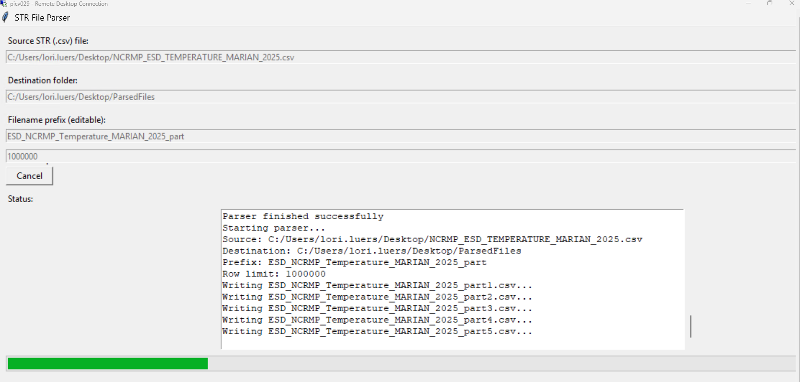

# Description
- Parse PIFSC ESD NCRMP Water Temperature data single .csv database exports into multiple split files and a README to assist in archive package preparation.
- Next directions: have it automate refreshing materialized view, then export, then process csv, prep whole package with csv, zipped csv, zipped folder of parsed files, QC report, and README

Subsurface Temperature Recorder (STR) Package  contains:
- 1 single csv file (database export e.g. MV_OCC_STR_NCEI_MARIAN_ERRDAP)
- 1 zipped single csv file
- 1 zipped folder of parsed files
- 1 README explaining contents
- generated QC pdf report
  
InPort record also required to be updated. More information on this survey method with SOP, metadata records, etc. located here: https://noaa-pifsc.github.io/esd-arp-resources/surveys/str

# Requirements
- Python

# Features
- Logging
- Progress Bar

# Developer
- LoriLuers-PIFSC (Lori Luers)

